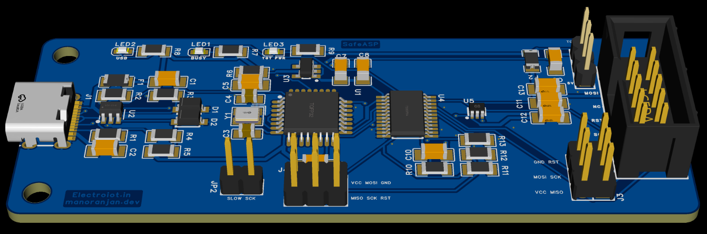
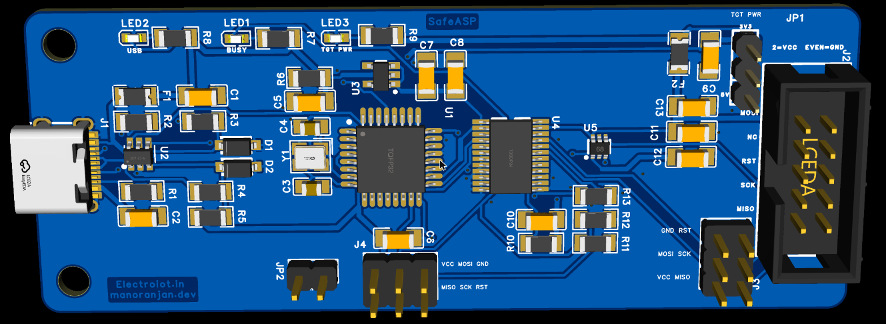
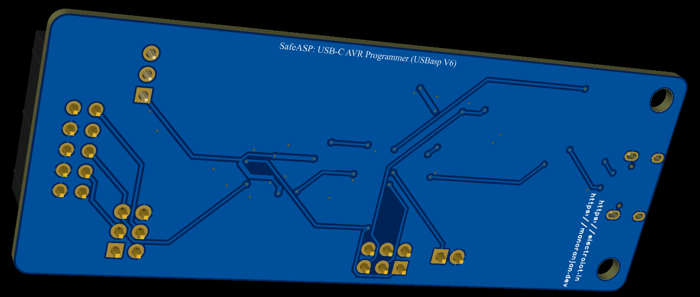
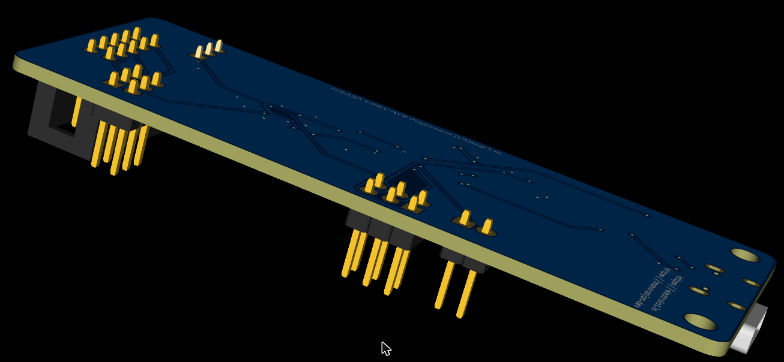
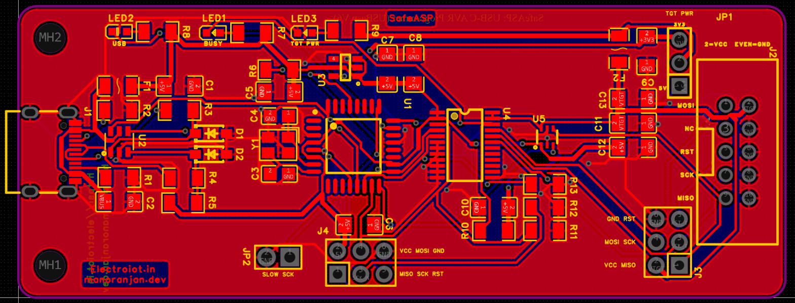
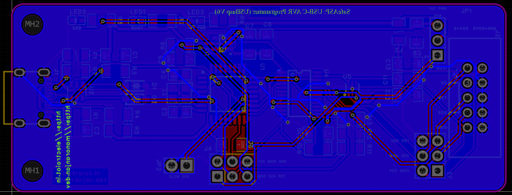

<h1 align="center">SafeASP · USB-C AVR Programmer</h1>

<p align="center"><i>USBasp V6</i></p>

<p align="center">
  <b>The classic USBasp, rebuilt for today:</b> USB-C, safe 1.8–5.5 V targets, protected target power, 10-pin <i>and</i> 6-pin ISP.<br>
  Open hardware by <a href="https://github.com/ElectroIoT">ElectroIoT</a> · successor to USBasp v4 / v5
</p>

<p align="center"><a href="https://electroiot.github.io/SafeASP/"><b>🌐 Open the live design pages →</b></a></p>

<p align="center">
  
  
  
  
  
  
</p>

<p align="center"></p>

> **Status (2026-11-19): PCB routed, DRC clean.** Schematic and 2-layer PCB are drawn in EasyEDA: 84 × 32 mm, all nets routed, 0.5 mm power tracks, GND pours on both layers, DRC 0 errors. **Not built or tested yet.** Next: Gerbers and the first boards.

## Gallery

| Top (3D) | Back (3D) |
|:---:|:---:|
|  |  |
| **Angled (3D)** | **Back, low angle (3D)** |
|  |  |
| **PCB top layer (2D)** | **PCB bottom layer (2D)** |
|  |  |

Renders from the EasyEDA 3D viewer, 2-layer board 84 × 32 mm. The planning floor plan is in [docs/images/pcb-floorplan.svg](docs/images/pcb-floorplan.svg).

---

## Why SafeASP (V6)?

| | v4 (2018) | v5 (2019) | **SafeASP / V6 (this repo)** |
|---|---|---|---|
| USB connector | USB-B | micro-USB | **USB-C** (works with C-to-C cables) |
| MCU / firmware | ATmega8 + USBasp | ATmega8 + USBasp | ATmega8A-AU + **the same USBasp firmware, unchanged** |
| 3.3 V targets | 5 V signals into the target | 5 V signals into the target | **Level shifter: signals follow the target's own VCC (1.8–5.5 V)** |
| Target power | 5 V, no protection | 5 V, no protection | **5 V / 3.3 V / off jumper, 200 mA PTC fuse, LED** |
| USB protection | – | – | **500 mA PTC + USBLC6 ESD** |
| ISP connector | 6-pin in a row | 6-pin in a row | **Standard 10-pin box header + 6-pin (Arduino ICSP)** |
| Firmware update | jumper on the ISP header | jumper on the ISP header | **Separate 6-pin port (J4)** |
| Board | 29 × 76 mm | 31 × 68 mm | 84 × 32 mm, 2 layers |

## Features

- 🔌 **USB-C** with a separate 5.1 kΩ on CC1 and CC2, so it powers up from USB-C to USB-C cables, laptops and chargers.
- 🛡️ **Safe for 3.3 V and 1.8 V chips.** A 74LVC8T245 drives MOSI, SCK and RST, and a 74LVC1T45 brings MISO back. Both run from the target's VCC (ISP pin 2).
- 💤 **Releases the target pins when idle.** The shifter is only enabled while the red BUSY LED is on (PC1, the same line the firmware already drives), so it never fights the target's own use of MOSI, SCK or RST.
- ⚡ **Protected target power**: jumper JP1 for 5 V, 3.3 V (AP2112K LDO) or off, a 200 mA resettable fuse, and a yellow "powering target" LED.
- 🧷 **Both ISP connectors**: a keyed 2×5 box header and a 2×3 header.
- 🐢 **Slow-SCK jumper** (JP2) for chips that are still on their 1 MHz factory clock.
- 🔁 **Easy self-update** through its own 6-pin port J4.
- 🧩 **Stock firmware.** The pin use was checked against the USBasp 2011-05-28 source, so the official hex works as-is with `avrdude -c usbasp` and the Arduino IDE.

## Design pages

The design is documented as four interactive pages: search the BOM, tick parts and wires off as you go, and hover a net to highlight it.

| Page | What's in it |
|---|---|
| [**BOM**](https://electroiot.github.io/SafeASP/bom.html) | 45 parts, about **USD 3.94** per board (first LCSC price tier), LCSC numbers, "copy all C-numbers" button |
| [**Wiring by section**](https://electroiot.github.io/SafeASP/wiring-by-section.html) | connection map, ATmega8A pin table, every pin-to-net per part |
| [**Schematic by section**](https://electroiot.github.io/SafeASP/schematic-sections.html) | three sheets, step-by-step build list, pin guides for the ATmega8A, level shifters and USB-C |
| [**PCB floorplan**](https://electroiot.github.io/SafeASP/pcb-floorplan.html) | 84 × 32 mm board, block boxes, X / Y position of every part |

The pages are live on GitHub Pages at **https://electroiot.github.io/SafeASP/** (they also work offline from the `docs/` folder). The BOM is also available as [CSV](hardware/bom/usbasp-v6-bom.csv) and as a [Markdown table](hardware/bom/bom-table.md).

## How it works

```
USB-C ──► ESD + PTC ──► V-USB (68R, 3.6 V zeners, 2k2) ──► ATmega8A @ 12 MHz, 5 V
                                                              │  MOSI/SCK/RST (5 V)
                                          BUSY_N (PC1) ──► OE#│
                                                              ▼
            JP1 5 V / 3.3 V / off ──► F2 ──► VTGT ──► 74LVC8T245 / 74LVC1T45 ──► 10-pin + 6-pin ISP
                                                       (target side = VTGT)
```

| ATmega8A pin (TQFP) | Net | Use |
|---|---|---|
| PB0 (12) | USB_DN | USB D− |
| PB1 (13) + PD2/INT0 (32) | USB_DP | USB D+ |
| PB2 (14) / PB3 (15) / PB4 (16) / PB5 (17) | RST / MOSI / MISO / SCK | ISP, through the level shifter |
| PC0 (23) | LED_G_K | green LED, USB ready |
| PC1 (24) | BUSY_N | red LED + level-shifter enable |
| PC2 (25) | SLOW_SCK | JP2 slow-SCK jumper |

## Using it

1. Plug in USB-C. The green LED comes on.
2. Set **JP1**: **1–2** sends 5 V to the target, **2–3** sends 3.3 V, **no jumper** if the target has its own supply. Never fit JP1 while the target is self-powered.
3. Connect the 10-pin or the 6-pin cable (pin 1 to pin 1).
4. Program:

```bash
avrdude -c usbasp -p m328p -U flash:w:firmware.hex:i
```

Arduino IDE: **Tools → Programmer → USBasp**, then **Sketch → Upload Using Programmer** or **Tools → Burn Bootloader**.

The level shifter takes its target-side supply from ISP pin 2, so the target must be powered, either by JP1 or by its own supply. Otherwise avrdude reports that the target does not answer.

## Firmware

V6 uses the official USBasp firmware by Thomas Fischl, unchanged. [firmware/README.md](firmware/README.md) explains where to get the hex, the fuse settings, how to flash a new board through J4, and the Windows driver.

## Repository layout

```
docs/            interactive design pages (BOM, wiring, schematic, PCB floorplan) + images
hardware/bom/    BOM as CSV and Markdown (LCSC part numbers)
firmware/        how to get and flash the USBasp firmware
tools/           Python generator for all pages and BOM files (python -X utf8 -I tools/gen_docs.py)
PLAN.md          design decisions, checks done, open items
```

## Roadmap

- [x] Circuit, netlist, BOM with LCSC numbers, PCB floor plan (2026-11-13)
- [x] EasyEDA schematic and PCB, routed, DRC clean (2026-11-19)
- [ ] Gerbers, BOM and pick-and-place files
- [ ] First boards built and tested (3.3 V and 5 V targets, C-to-C cable)
- [ ] Shared project page for ordering the PCB

## Older versions

- **v5 (micro-USB, 2019)** and **v4 (USB-B, 2018)**: Gerber files are on the PCBWay shared-project pages (*USBasp Programmer v5 Updated* and *USBasp Updated v4*).
- Build guide for v5: [hackster.io: USBasp Programmer DIY](https://www.hackster.io/Manoranjan2050/usbasp-programmer-diy-9302ea).

## Credits and license

- USBasp firmware and the original circuit: © Thomas Fischl, [fischl.de/usbasp](https://www.fischl.de/usbasp/), GPL-2.0. It is built on V-USB by OBJECTIVE DEVELOPMENT.
- SafeASP (USBasp V6) hardware design, docs and generator: ElectroIoT, licensed **CC BY-SA 4.0** (see [LICENSE](LICENSE)).
